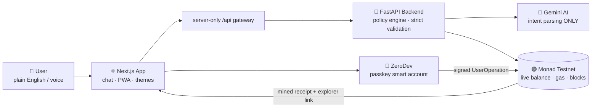
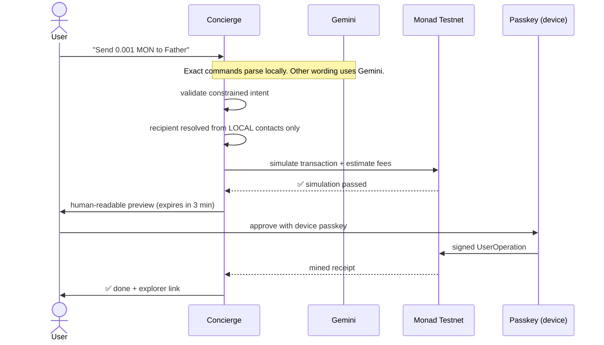
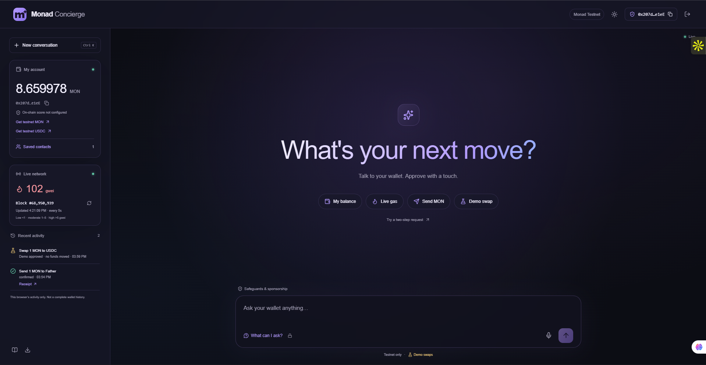
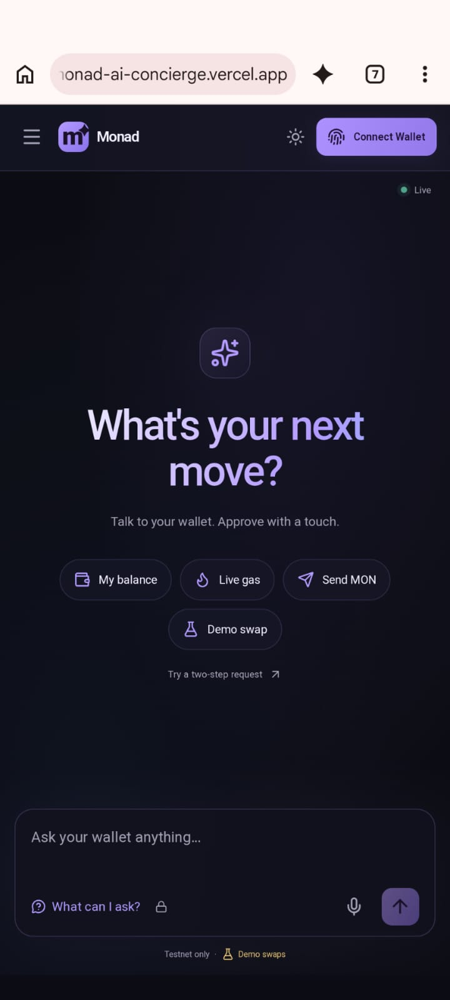
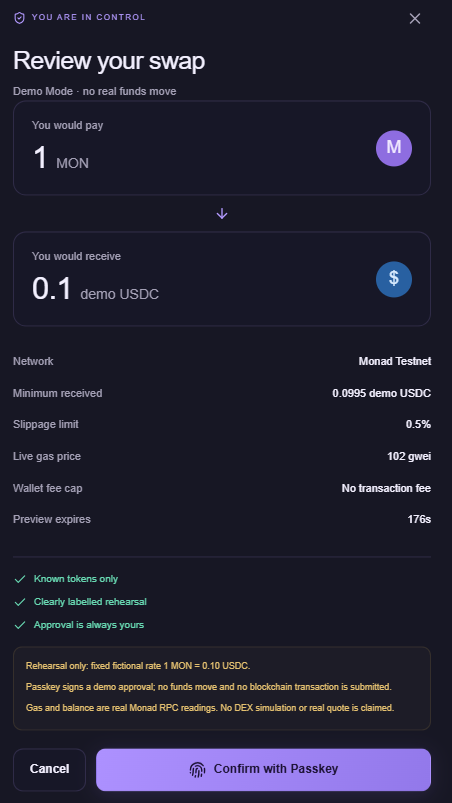
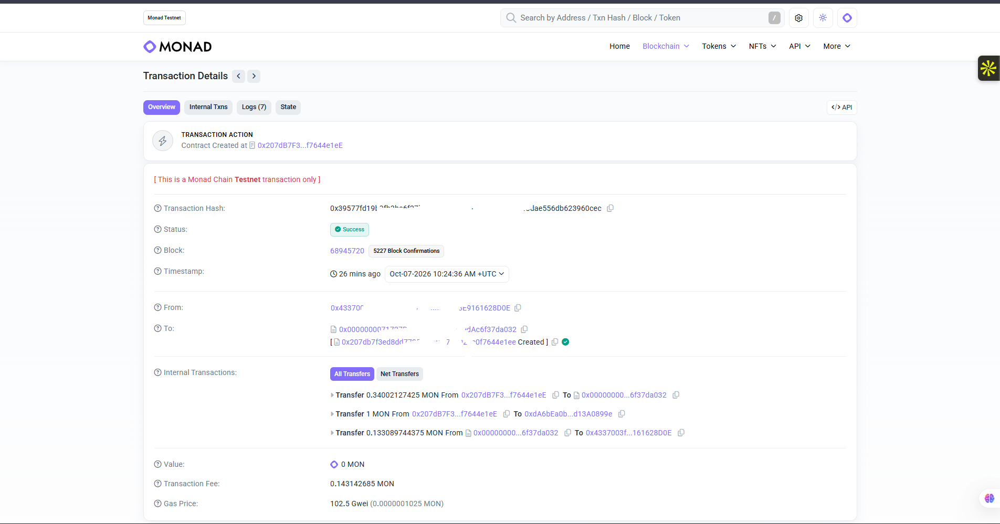

# Monad Concierge

A passkey wallet for Monad Testnet: ask by text or voice, review, and approve.

**Live app:** https://monad-ai-concierge.vercel.app

**Demo guide:** https://monad-ai-concierge.vercel.app/demo-guide

---

## 😖 The Problem

Blockchain finance is powerful — but the interface is hostile:
seed phrases, gas fees, token approvals, slippage settings.
Normal people give up within two minutes.

## 💡 The Solution

A **chat-first wallet**. You speak. It verifies. You approve.

| You say                        | Concierge does                                                                   |
| :----------------------------- | :------------------------------------------------------------------------------- |
| *"Check my balance"*         | Reads the live chain instantly — no AI needed                                   |
| *"Send 0.001 MON to Father"* | Resolves contact locally, simulates, shows fees →**fingerprint approval** |
| *"Swap 1 MON to USDC"*       | Live PuddleSwap V2 quote → review minimum received and fees → passkey approval |

---

## 🏗️ Architecture — How the Agent Works



> **Golden rule:** *The AI can propose. Only code validates. Only the human approves.*

### The approval flow, step by step



---

## ✨ Feature Highlights

|                                      |                                                                                 |
| :----------------------------------- | :------------------------------------------------------------------------------ |
| 🔐**Passkey-first wallet**     | Device passkey login via ZeroDev smart accounts — no seed phrases              |
| 💬**Natural language + voice** | Gemini interprets intent; exact commands still work during AI outages           |
| 💸**Real testnet transfers**   | MON & Circle USDC with RPC simulation, balance/fee checks and expiring previews |
| 🧾**Live network widget**      | Gas price (green/amber/red) + block height, refreshed every 5 s                 |
| 👥**Local contacts**           | Recipients come only from your saved address book — never from AI guesses      |
| 🔁**Two-step intents**         | *"Check my balance, and if I have more than 3 MON, swap 2 to USDC"*           |
| ⛽**Optional gas sponsorship** | ZeroDev paymaster; refusal never silently switches to user-paid                 |
| 📱**Installable PWA**          | Android/iOS home-screen app with offline-safe screen                            |
| 🤖**Optional extras**          | Telegram bot + on-chain activity score contract                                 |

---

## 🎯 Track Alignment

| Track                                        | How we hit it                                                                              |
| :------------------------------------------- | :----------------------------------------------------------------------------------------- |
| **02 — Consumer Products & Payments** | Blockchain is invisible: chat UI, passkey login, plain-language previews                   |
| **04 — Trust, Identity & AI Infra**   | Passkey-native accounts (WebAuthn/P-256), constrained AI agent, on-chain activity receipts |

## ✅ Implementation Status

| Feature                                     | Status                                                        |
| :------------------------------------------ | :------------------------------------------------------------ |
| Balance / gas / block reads                 | ✅ Real, live RPC                                             |
| MON & USDC transfers                        | ✅ Real preparation + passkey-signed UserOperations (testnet) |
| Swaps                                       | Real MON-to-USDC swaps through PuddleSwap V2 (testnet)        |
| Gas sponsorship / Telegram / activity score | ⚙️ Implemented, optional external setup                     |

## 🛡️ Safety Rules

- Every state-changing action requires **explicit passkey approval**
- Previews **expire in 180 s** and are re-validated before signing
- Unknown tokens, invented recipients, tampered previews → **rejected**
- Read-only demo account **cannot sign**
- Provider credentials never touch `NEXT_PUBLIC_*` variables

---

## 📸 Screenshots

|                 Desktop                 |               Mobile PWA               |
| :--------------------------------------: | :------------------------------------: |
|  |  |

|              Passkey approval              |          Live transfer receipt          |
| :----------------------------------------: | :--------------------------------------: |
|  |  |

---

## Run locally on Windows

Install Node.js/npm and a Python version supported by the backend dependencies. From the project root:

```powershell
python -m venv backend/.venv
.\backend\.venv\Scripts\python.exe -m pip install -r backend/requirements.txt
npm ci --prefix frontend
```

For a fresh checkout, copy `backend/.env.example` to `backend/.env` and `frontend/.env.example` to `frontend/.env.local`. Preserve existing configured files.

| File                    | Configuration                                                                                                                                       |
| ----------------------- | --------------------------------------------------------------------------------------------------------------------------------------------------- |
| `backend/.env`        | `AI_PROVIDER=gemini`, `GEMINI_API_KEY`, independent random `API_ACCESS_TOKEN` and `PREVIEW_SECRET`, `SWAP_MODE=puddleswap_v2`             |
| `frontend/.env.local` | `BACKEND_URL=http://127.0.0.1:8000`, matching `BACKEND_API_TOKEN`, ZeroDev Monad Testnet `ZERODEV_RPC_URL` and `ZERODEV_PASSKEY_SERVER_URL` |
| Optional sponsorship    | Paymaster URL and`SPONSOR_GAS=true`, after configuring a valid ZeroDev gas policy                                                                 |

Keep secrets out of Git and `NEXT_PUBLIC_*`. No customer private key is required. Localhost and production use separate passkeys; see [deployment setup](DEPLOYMENT.md).

Start two PowerShell terminals from the root:

```powershell
# Terminal 1
.\backend\.venv\Scripts\python.exe -m uvicorn app.main:app --host 127.0.0.1 --port 8000 --reload
```

```powershell
# Terminal 2
cd frontend
npm run dev
```

Open **http://localhost:3000** in Chrome or Edge. Restart servers after environment changes. Use `backend/.venv`, not `backend/venv`. If port 8000 is occupied or restricted, choose an available port such as 8001 and update frontend `BACKEND_URL` to match.

## Try it

- `Check my balance` or `Check my USDC balance`.
- Save a verified contact and ask `Send 0.001 MON to Father`.
- `Swap 0.01 MON to USDC`: review the real testnet preview, approve, wait for a successful receipt, then refresh USDC in the sidebar.
- `Check my balance, and if I have more than 5 MON, swap 2 to USDC`: review the condition and continue to the preview before approval.
- Enable the speaker beside the microphone for spoken replies and authorization instructions. Stop/replay and voice selection are available. No voice API key is required; selecting a voice changes pronunciation, not translation. Spoken input/output cannot authorize payments.

Funding must go to the displayed smart-account address and include the full wallet fee. Try Demo Account is read-only. Recent activity shows this browser’s actions; it is not a complete indexed history. Localhost and production passkeys are separate. Install the PWA from a supported mobile browser on the HTTPS site; physical installation and passkeys need device testing.

## Tests and deployment

```powershell
.\backend\.venv\Scripts\python.exe -m pip install -r backend/requirements-dev.txt
.\backend\.venv\Scripts\python.exe -m pytest backend/tests
npm run test --prefix frontend
npm run typecheck --prefix frontend
# Requires local servers and installed Playwright Chromium
npm run test:e2e --prefix frontend
```

The live-swap release passed 216 backend tests and 38 desktop/mobile browser tests. Spoken replies passed 44 frontend unit tests, eight targeted desktop/mobile browser tests, TypeScript and the production build. Production speaker controls were checked without page errors. Speech tests use mocks; physical audible output and a funded signed swap were not verified by these diagnostics. Virtual passkey registration/recovery and unsigned live RPC/bundler simulations passed.

For the linked Vercel projects, `pwsh -File scripts/sync-production-env.ps1 -Deploy` uploads configured server-side values and redeploys both projects. Review configuration first and never commit secret environment files. See [DEPLOYMENT.md](DEPLOYMENT.md) and [deployment.json](deployment.json).

## Structure

```text
backend/       FastAPI, policies, chain adapters and tests
frontend/      Next.js, passkey wallet, PWA, speech and UI tests
contracts/     Optional on-chain activity contract
scripts/       Startup, configuration, deployment and smoke checks
docs/          Submission screenshots
```

## Scope and optional integrations

Current local and production configuration uses `SWAP_MODE=puddleswap_v2`. Optional `mock` mode is explicitly labelled and moves no funds. Only MON-to-Circle-testnet-USDC swaps are enabled; arbitrary token pairs and mainnet are not supported. Transfers have no fixed 10 MON ceiling, but positive amounts, precision, actual balance and full fees are checked.

PuddleSwap is an unaudited testnet DEX. Contract identity checks and simulation are not a security audit. A successful receipt is required before claiming payment or swap completion.

Sponsorship needs a configured ZeroDev policy/paymaster and `SPONSOR_GAS=true`. Telegram needs an owner token, numeric allowlist and a persistent worker; Vercel does not run that worker. The optional activity contract needs separate deployment and counts successful MON payments, not reputation or creditworthiness. Browser voices/recognition may use online services.

[Architecture](ARCHITECTURE.md) · [Deployment](DEPLOYMENT.md) · [Demo walkthrough](DEMO.md) · [Optional integrations](ADVANCEMENTS.md) · [Test evidence](backend/TEST_RESULTS.md)

## 📄 License

MIT © Arav Mittal — see [LICENSE](LICENSE).

*Testnet hackathon demo. Not a mainnet financial service.*
