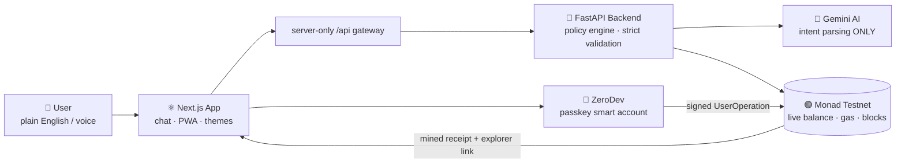
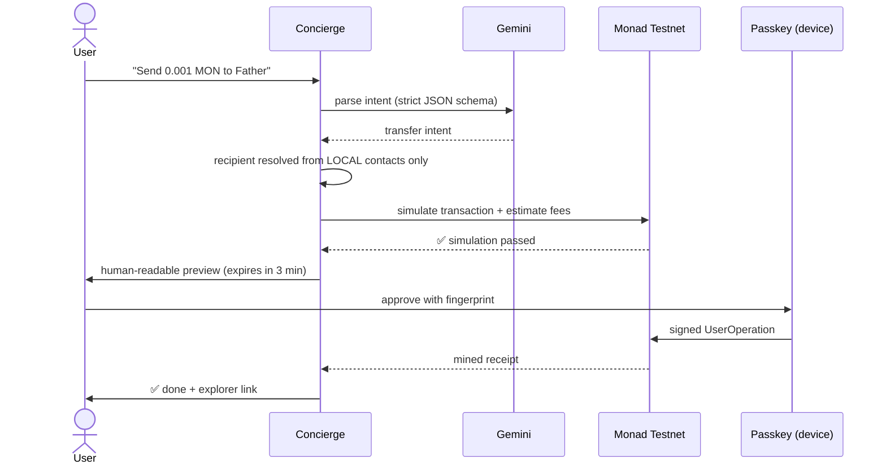

<div align="center">

---

## 😖 The Problem

Blockchain finance is powerful — but the interface is hostile:
seed phrases, gas fees, token approvals, slippage settings.
Normal people give up within two minutes.

## 💡 The Solution

A **chat-first wallet**. You speak. It verifies. You approve.

| You say                        | Concierge does                                                                   |
| :----------------------------- | :------------------------------------------------------------------------------- |
| *"Check my balance"*         | Reads the live chain instantly — no AI needed                                   |
| *"Send 0.001 MON to Father"* | Resolves contact locally, simulates, shows fees →**fingerprint approval** |
| *"Swap 1 MON to USDC"*       | Clearly-labelled rehearsal preview — no funds move                              |

---

## 🏗️ Architecture — How the Agent Works



> **Golden rule:** *The AI can propose. Only code validates. Only the human approves.*

### The approval flow, step by step



---

## ✨ Feature Highlights

|                                      |                                                                            |
| :----------------------------------- | :------------------------------------------------------------------------- |
| 🔐**Passkey-first wallet**     | FaceID / fingerprint login via ZeroDev smart accounts — no seed phrases   |
| 💬**Natural language + voice** | Gemini interprets intent; exact commands still work during AI outages      |
| 💸**Real testnet transfers**   | MON & Circle USDC with RPC simulation, amount caps, expiring previews      |
| 🧾**Live network widget**      | Gas price (green/amber/red) + block height, refreshed every 5 s            |
| 👥**Local contacts**           | Recipients come only from your saved address book — never from AI guesses |
| 🔁**Two-step intents**         | *"Check my balance, and if I have more than 3 MON, swap 2 to USDC"*      |
| ⛽**Optional gas sponsorship** | ZeroDev paymaster; refusal never silently switches to user-paid            |
| 📱**Installable PWA**          | Android/iOS home-screen app with offline-safe screen                       |
| 🤖**Optional extras**          | Telegram bot + on-chain activity score contract                            |

---

## 🎯 Track Alignment

| Track                                        | How we hit it                                                                              |
| :------------------------------------------- | :----------------------------------------------------------------------------------------- |
| **02 — Consumer Products & Payments** | Blockchain is invisible: chat UI, passkey login, plain-language previews                   |
| **04 — Trust, Identity & AI Infra**   | Passkey-native accounts (WebAuthn/P-256), constrained AI agent, on-chain activity receipts |

## ✅ Honest Status: Real vs Rehearsal

| Feature                                     | Status                                                        |
| :------------------------------------------ | :------------------------------------------------------------ |
| Balance / gas / block reads                 | ✅ Real, live RPC                                             |
| MON & USDC transfers                        | ✅ Real preparation + passkey-signed UserOperations (testnet) |
| Swaps                                       | 🧪 Clearly-labelled off-chain rehearsal — no funds move      |
| Gas sponsorship / Telegram / activity score | ⚙️ Implemented, optional external setup                     |

## 🛡️ Safety Rules

- Every state-changing action requires **explicit passkey approval**
- Previews **expire in 180 s** and are re-validated before signing
- Unknown tokens, invented recipients, tampered previews → **rejected**
- Read-only demo account **cannot sign**
- Provider credentials never touch `NEXT_PUBLIC_*` variables

---

## 📸 Screenshots

|                 Desktop                 |               Mobile PWA               |
| :--------------------------------------: | :------------------------------------: |
|  |  |

|              Passkey approval              |          Live transfer receipt          |
| :----------------------------------------: | :--------------------------------------: |
|  |  |

---

## 🚀 Run Locally (2 commands)

```powershell
pwsh -File scripts/start.ps1
# open http://localhost:3000
```

Fresh checkout: `backend/` → `python -m venv .venv` → install `requirements-dev.txt` → copy `.env.example`; `frontend/` → `npm ci` → copy `.env.example`. See [RUN_LOCAL.md](RUN_LOCAL.md).

## 🧪 Testing — 176 passing checks

```powershell
.\backend\.venv\Scripts\python.exe -m pytest backend/tests -q   # 124 backend/contract
npm --prefix frontend run test                                  # 32 frontend safety
.\backend\.venv\Scripts\python.exe scripts/production-smoke.py --ai
```

Plus 20 desktop/mobile browser acceptance cases, PWA offline checks, and typecheck/build gates.

## 🗂️ Structure

```
backend/app/        FastAPI routes · policies · RPC · deterministic builder
backend/tests/      schema · policy · preview · auth · simulation checks
frontend/app/       Next.js pages + server-only API gateway
frontend/lib/       typed API · chain helpers · ZeroDev passkey wallet
scripts/            launcher · config check · production smoke
```

## 📚 Deep Dives

[Architecture](ARCHITECTURE.md) · [Deployment](DEPLOYMENT.md) · [Judge Walkthrough](DEMO.md) · [Feature Status](ADVANCEMENTS.md) · [Test Evidence](backend/TEST_RESULTS.md)

## 📄 License

MIT © Arav Mittal — see [LICENSE](LICENSE).

*Testnet hackathon demo. Not a mainnet financial service.*
